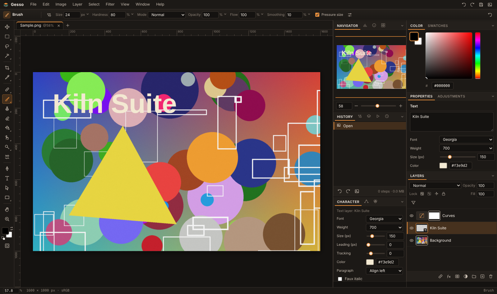
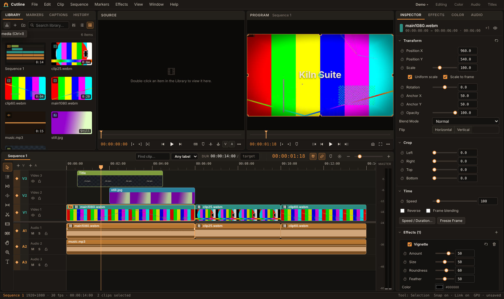

# Kiln Suite

Two creative apps that run straight from a folder in your browser. Nothing to install, no build step, no server, no account — your files never leave your computer.

| App | What it is | Open |
|---|---|---|
| **Gesso** | Layered raster image editor — brushes, selections, masks, adjustment layers, text, vectors, filters, animation | `Gesso/index.html` |
| **Cutline** | Multitrack non-linear video editor — real-time GPU effects and transitions, color grading, titles, captions, audio mixing, WebCodecs export | `Cutline/index.html` |




## Quick start

1. Download or clone this repository.
2. Double-click `Gesso/index.html` or `Cutline/index.html`.
3. Use **Chrome or Edge** (recent versions). They have the best support for pen pressure, the File System Access API (save-in-place) and hardware video encoding. Firefox and Safari load the apps but several features — WebCodecs export, AudioWorklet effects, save-in-place — are missing or partial.

That's it. The apps are plain HTML, CSS and JavaScript: edit a file, refresh the tab.

**Windows shortcuts:** double-click `tools\Create Desktop Shortcuts.bat` to get **Gesso** and **Cutline** on your desktop with their own icons. They open in Chrome or Edge as standalone windows (no tabs or address bar, their own taskbar entries). Add `-StartMenu` for Start-menu entries as well.

### Shortcuts the browser keeps for itself
Chrome and Edge reserve **Ctrl+N, Ctrl+T, Ctrl+W and Ctrl+Tab**, so the apps use alternatives:
- Gesso: **Ctrl+Alt+N** new document · **Ctrl+Alt+T** free transform · **Ctrl+Alt+W** close.
- Cutline: **Ctrl+Alt+N** new project · **Ctrl+Alt+Shift+N** new sequence · **Ctrl+Alt+T** new title at the playhead.

Every shortcut can be rebound in **Help ▸ Keyboard Shortcuts** (F1). Gesso's **View ▸ Full Screen** (F11) uses the Keyboard Lock API so the browser's own shortcuts reach the app.

## Gesso — image editor

- **Layers**: pixel, text, shape, adjustment, group, embedded object (non-destructive scaling); masks, clipping masks, blend modes, Blend If, layer styles, Layer Comps, Smart Filters.
- **Selection**: marquee, lasso, polygonal, magnetic lasso (live-wire), magic wand, Select Subject, Refine Edge, Quick Mask, Color Range.
- **Painting**: pressure-sensitive brush engine with stabilizer, symmetry, jitter, wet edges, airbrush build-up; custom brushes and patterns; clone, healing, Remove, Patch Fill, History Brush, Color Replacement, Flow Warp.
- **Transform**: free transform with perspective, Mesh Warp, Content-Aware Scale (seam carving), Perspective Crop, Straighten, Auto-Align Layers, Merge Exposures.
- **Adjustments & filters**: 22 adjustments (Levels, Curves, HSL, Color Balance, Match Color, Develop…) and 58 filters, a Filter Gallery, .cube LUT import, Histogram and Palette panels.
- **Type & vector**: paragraph and point text, text on a path, Text Warp, Convert Text to Shape; editable shapes with per-corner radius, gradients, Align/Distribute, Combine Shapes, SVG import/export.
- **Animation**: frame animation from layer states with tweening; export as GIF, APNG or WebM.
- **Automation**: Actions with batch processing, Contact Sheet, Data-Driven Export from CSV, Export Layers / Layer Comps to files, export presets.
- Projects are saved as `.kgesso` (files from the pre-release `.kstrata` format still open); export to PNG, JPEG, WebP, SVG, .cube LUT or HALD image.

## Cutline — video editor

- **Timeline**: unlimited video/audio tracks, ripple/roll/slip/slide trimming, snapping, linked selection, markers, nested sequences, multicam, subclips, speed ramps with frame blending, Remove Silences, Detect Scene Cuts, Split at Markers, Find Problem Frames (QC).
- **Picture**: 70+ effects (color, looks, blur/sharpen, stylize, distort, keying incl. Track Matte, VHS, Old Film, Lens Flare…), 30+ transitions, masks with feather and motion tracking, Steady Cam stabilization, Censor Region, effect presets.
- **Color**: grading panel with color wheels and curves, HSL Secondary, Match Color, white balance picker, scopes (waveform, vectorscope, histogram, false color), .cube LUT in and out.
- **Audio**: mixer with track gains and meters, EQ, compressor, gate, de-esser, limiter, spectral Noise Reduction, Voice Polish chain, Normalize Loudness (LUFS), auto-ducking, beat markers, master limiter, Audio Spectrum generator.
- **Titles & captions**: animated title designer with templates, per-word animations, shapes, progress bars, timecode burn-in; SRT import/export and caption styling.
- **Export**: WebM (VP9/VP8/AV1), MP4 (H.264/HEVC/AV1 where the browser can encode them), WAV, GIF, PNG frame/sequence, contact sheet, SRT, YouTube chapters; delivery presets, batch queue, in-to-out render cache, EDL and FCP 7 XML interchange. Hardware encoders (NVENC, Quick Sync, AMF) are used when the browser exposes them.
- **Long files**: 10-hour recordings import in seconds with streamed audio, background waveforms and proxies.
- Projects are saved as `.kcut` and point to your media by file name; the app asks you to relink if the files move.

## Project layout
```
Gesso/     index.html · css/ · js/core (document, layers, compositor) · js/tools · js/ui · js/app
Cutline/    index.html · css/ · js/core · js/model · js/media · js/playback · js/render · js/audio · js/ui · js/export · js/io
shared/     theme.css (the shared look) · imagefx.js (adjustments + filters, used by both) · animenc.js (GIF/APNG encoders)
_tests/     Playwright end-to-end suites for both apps (see _tests/README.md)
docs/       screenshots
tools/      Windows shortcut installer (.bat + .ps1)
```
Everything is classic script-tag JavaScript — no modules, no bundler, no CDN. Workers and AudioWorklets are created from Blob/data URLs so the apps keep working from `file://`.

## Tests
The suites drive the real UI in headless Chromium with mouse and keyboard input.
```
npm install          # installs Playwright and a Chromium build
npm run test:quick   # ~10-minute smoke pass over both apps
npm test             # everything (2–3 hours; runs scripts one at a time on purpose)
npm run test:media   # regenerates the one large test clip that is not kept in git (needs ffmpeg)
```
See `_tests/README.md` for the groups and how to run a single script.

## Contributing
Bug reports and pull requests are welcome — see [CONTRIBUTING.md](CONTRIBUTING.md). The short version: keep it plain JavaScript that runs from `file://`, add or extend a test for what you change, and run `npm run test:quick` before opening a PR.

## License
MIT — see [LICENSE](LICENSE). © 2026 Thomas Rigdon.

Gesso, Cutline and Kiln Suite are original work; the names, icons, theme and file formats are not derived from any other product.
